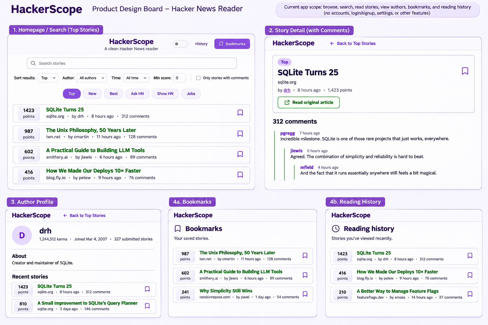
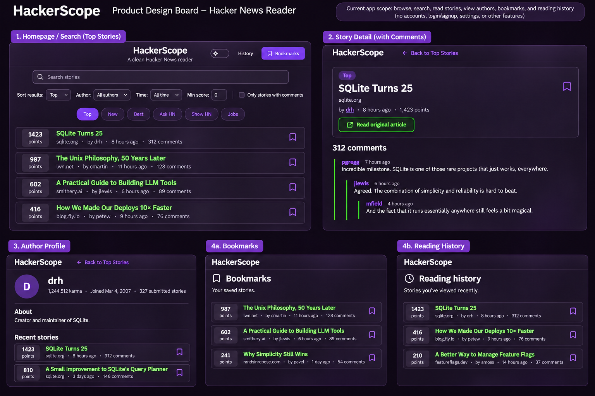

# HackerScope

HackerScope is a responsive Hacker News reader built with Next.js. Browse stories, search Hacker News, read comments, view author profiles, save bookmarks, and revisit reading history.

## Wireframes

### Light theme



### Dark theme



## Technologies

- Next.js and React
- Redux Toolkit and React Redux
- Hacker News Firebase API for stories, comments, and user profiles
- Algolia Hacker News Search API
- CSS Modules
- Jest and React Testing Library for component tests
- Playwright for end-to-end tests

## Features

- Browse Top, New, Best, Ask HN, Show HN, and Jobs stories
- Search stories with sorting and filters for author, time range, minimum score, and stories with comments
- View story details and threaded comments
- Open author profiles with karma, join date, about information, and recent stories
- Bookmark stories and view reading history
- Switch between light and dark themes
- Use the app on desktop, tablet, and mobile screens

## Run locally

1. Install dependencies:

   ```bash
   npm install
   ```

2. Start the development server:

   ```bash
   npm run dev
   ```

3. Open [http://localhost:3000](http://localhost:3000).

## Run tests

Run component tests:

```bash
npm test -- --runInBand
```

Run end-to-end tests:

```bash
npx playwright test
```

## Future work

- Consider adding optional user accounts later.
